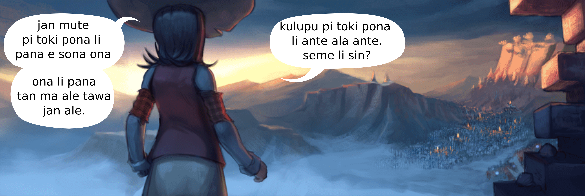
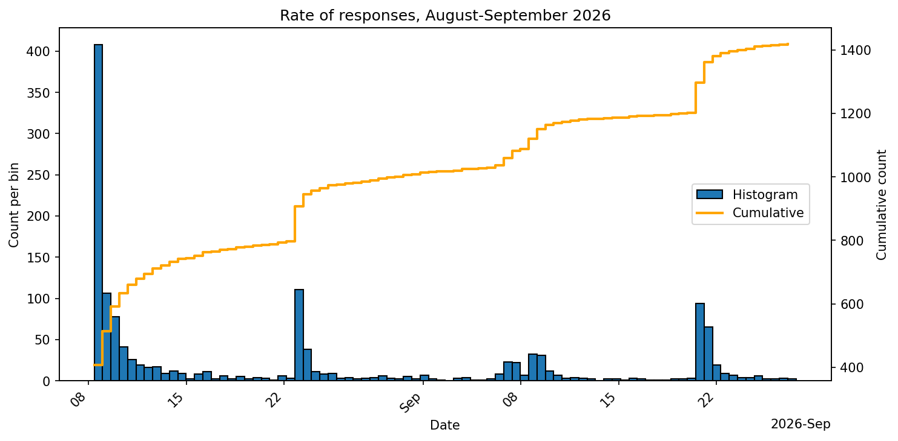



 <figure>
    
  <figcaption><small>Art: David Revoy, <a href="https://www.davidrevoy.com" target="_blank">www.davidrevoy.com</a></small></figcaption>
</figure> 
<small>
Go [here]() for a list of pointers to resources mentioned in the census.
</small>

How has the Toki Pona community changed since August 2024? What about their numbers? Do people often visit ma pona pi toki pona? Do they meet up with other tokiponists? What books do they own? Find out about this and much more in the results of the fourth Toki Pona census!

August 08, 2026. After 2 years since the third census, we released this one on Toki Pona’s anniversary. We closed it after about 6 weeks, as last times, receiving 1419 responses, which is 29% less than last time. There are a few _conjectured_ reasons for this drop: one is that other two large surveys were released on the same day and people were probably not receptive to so many forms. It's been discussed to separate the release of big surveys in time in the future. Another possible reason is that Toki Pona is getting fewer people now than it used to be. It seems that most people learned about the existence of Toki Pona online, where youtube played a big role. Even though Toki Pona content is increasing, there may not have been enough content promoting Toki Pona to the world lately, or the internet is pulling everyone's attention to something else. These are only conjectures though, take them with a grain of salt.

Hi, I’m jan Tamalu and I have coordinated this project, analyzed the data, and made this post. Many people contributed to this project, such as jan Alonola, mun Kekan San, kala Asi, jan Jonatan and jan Tepo. 

This time, we had some new questions and others were slightly modified. People could decide to **only answer a few of the questions**, although most people reply to almost everything. The turnover of people responding to the census was again very high with 66% not having responded to a previous Toki Pona census, establishing again that lots of people come and go in the Toki Pona online community. o alasa e sona pona a!

<b>What to know before jumping to the results:</b>

- Tap/click on the graphs on small screens to reveal missing info, like bar labels.

- Each question has (1) a graph with results from <b>all</b> the responses (including tp respondents) and (2) one with results from the people that used the Toki Pona version of the form.

- Questions marked <b>(MA)</b> in the title allowed multiple answers. Their percentages can add up to more than 100%. We also wrote the number of people that answered each question.

<!--
- The two questions about numbers of people use ranges so that unusually large estimates do not flatten the rest of the chart. Paired totals and ma pona estimates were checked coordinate by coordinate, and inconsistent pairs were excluded. The learning-time question is similarly grouped into ranges of days and years.
-->

- Free-text answers were randomly shuffled.

---
# Intro
---

## Language used

As last time, we used a Google form in English and Toki Pona and a Tencent QQ form in Chinese and Toki Pona.
About one fifth of respondents used the Toki Pona form: 20.7%, up from 16.1% in 2024. The proportion has risen in every census so far. The Toki Pona-only charts have a useful sample of 294 responses, including two from the Tencent QQ form.

**Btw, I created [a Discord server](https://discord.gg/zTT77cra6Z) for playing and contributing to a game inspired by Toki Pona designed to grow the Toki Pona community. [This is a post about it]().**

## Sections filled

People could leave after any section, and 85.6% reached the fourth one. This is slightly below the 89.4% completion rate from 2024, which could be due to the census being a bit longer this year.

---
# Toki Pona ability
---

## Do you consider you know Toki Pona?

Anyone with any level of Toki Pona could respond to the census, including people who had only just started learning. Even so, about 85% now say that they know Toki Pona, compared with about 80% in 2024 and 74.2% in 2022. This is one of the clearest continuing changes across the censuses. There were three brave people that went for the Toki Pona form that marked they do not consider they know Toki Pona.

## Did you answer previous Toki Pona censuses?

About 66% were filling a Toki Pona census for the first time. This is still a large majority, although it is lower than the 77% observed in 2024, now that there are three previous censuses one could have answered. The turnover is again smaller in the Toki Pona group: 45% selected *ala*. Of all respondents counted here, 32% had answered the 2024 census, while a very small minority had answered an older census but not the 2024 one.

## Recent visits to ma pona pi toki pona

This question is new. We wanted to know how many respondents were around recently in the main Discord server. The answer is almost identical for the Toki Pona group and the full one.

## Toki Pona level

The distribution has again moved towards the higher Toki Pona levels. About 61% report at least an intermediate level, compared with 53% in 2024 and 44% in 2022. Advanced and fluent answers together also rose from about 20% to 24% since 2024. As expected, the Toki Pona respondents report a greater level. 

## How many Toki Pona people have you spoken with, and have they visited ma pona recently?

Two questions were made to see if we could obtain a nice lower bound on the number of tokiponists using a variant of the [scale-up method of indirect surveys](https://pmc.ncbi.nlm.nih.gov/articles/PMC10665021/). There will be a separate post explaining our findings and our method, since it differs from the classical scale-up method that tries to estimate the exact number and not a lower bound.

We asked how many people you know "interested in learning/using Toki Pona that you have ever had a conversation with? (online or in person, in any language)", and to report that number split by their level: (A) None / hasn't started learning (B) Beginner/Learner/Intermediate (C) Advanced/Fluent. These categories are defined in the previous question. We also asked "Out of those people how many do you think have visited the ma pona pi toki pona Discord in the last 3 months?". Then, we use the number of real visitors to ma pona to extrapolate.

There were 1071 responses, after excluding invalid ones, and 41% of them reported at least one beginner-to-intermediate person who had recently visited ma pona, and 46% knew at least one advanced or fluent visitor. The reach is much higher in the Toki Pona group.  Only 25 respondents described their own level as *None*, and they knew 9 people at level A (none/not started), 7 at level B (beginner/learner/intermediate), and 11 at level C (advanced/fluent). They estimated that 2, 4, and 5 of those people, respectively, had visited ma pona in the previous 90 days. Below in the plots, you can see the responses for the people with levels Beg.-int. or Adv-fl. about the people they know and their level A, B, or C. Dark blue represents how many people were estimated to have visited ma pona. 

Note that the total sum are not different people: two individuals knowing the same person would add 2 to the count. But I'll advance that the statistical method that accounts for multiplicities seems to estimate a lower bound of something between 5000 to 10000. This is only a lower bound of what we could reach with this survey. The future post that we'll publish on this website will contain the in-depth analysis, with the math behind it and  the more concrete response, along with confidence intervals of this statistical analysis.

You can also open the section below to see another visualization of the data.

  Per-respondent distributions
  

This version of the plots separates each of the six bars into two distributions, producing
12 box-and-whisker rows. The label *ma* refers to the respondent's
estimate for recent ma pona visitors and *not* to the remainder. Each box
contains the middle 50% of responses, the dark line is the median, the whiskers
use the usual 1.5 interquartile-range rule, and dots are outliers.

## Days to reach an intermediate reading/writing level

This is a cool new question. People often wonder how long it takes to get to an intermediate level of Toki Pona. In blue, we can see the self-reported days for achieving such a feat for reading/writing. On the right, we can see the number of days studied so far if the current level was lower. After the charts, you can see comments people wrote on their number.

About 67% placed themselves within the first six months and 84% within the first year. Among people below intermediate, 55% had been studying for at most 30 days. We excluded invalid answers from the plots.

Recall that we (loosely) defined what an intermediate level is in a previous question.



## How often is Toki Pona used?

The frequency distribution remains remarkably stable. About 47% use Toki Pona at least a few times per week, compared with 49% in 2024 and 47% in 2022. For the Toki Pona group it is 63%, again close to the value reported in both previous censuses.

## Toki Pona skills

Every skill rose relative to 2024. For example, 63% now say they can speak Toki Pona and 53% understand spoken Toki Pona, up from 56% and 45%. Knowing all the *pu* words rose from 76% to 83%. This does not mean the community improved their skills overall, just that this year the people that responded have better skills. Listening remains the lowest bar.

## Sign languages of Toki Pona

Luka Pona has the largest interested group, with 557 interested and 88 learning, but only 16 saying they
know it.  The proportions who know or are learning either system are close to 2024, but interest in Luka Pona has grown.

The same results on a logarithmic scale for easier clicking:

## Why do people learn Toki Pona?

Having fun is still the main reason to learn Toki Pona by far: 81% selected it, although
this is down from 88% in 2024. The Toki Pona group is different here, for the first time: becoming multilingual is its most common answer, ahead of fun.

I love to see in the comments "I will be paid £2 for learning it". In the second census ever in 2022 as well as in 2024, someone had replied "I was paid £2", which was very funny and also prompted me to offer £2 to a friend to learn Toki Pona, who accepted (not living in the UK myself I managed to get a £2 coin). Now, this year we see another person that will be paid £2 for learning Toki Pona, and I confirm that it is not my friend! a a a. Is this going to be a new trend in the community?!



## How did people first hear about Toki Pona?

The result is the same 86% as in 2024 for first hearing about Toki Pona online. Despite the considerable turnover between censuses, people keep finding Toki Pona through almost exactly the same broad routes. Below you can see specific comments on how people discovered Toki Pona.



## When did people start learning Toki Pona?

More than half of the respondents started in 2024+, and almost two thirds started in 2023+. The 2024 results already suggested that the earlier Toki Pona explosive growth had slowed down. In the log scale one can see exponential growth (a straight line in the chart) until about 2022 where then it gets lower. 

This curve should not be read as a direct population
count, since we know that most people stop being online around after a few years, so they do not fill out the census. Even if every year we had got the same amount of new people, it is likely that we would see an exponential curve because of people leaving the online communities. In any case, the growth of Toki Pona has clearly declined.

The 2026 bar only corresponds to the data until September, so for the full year it would be larger.

The same results on a logarithmic scale:

---
# Community and Toki Pona
---

## Do people own the language official books?

This question is broader than last time which was about the books about the language (pu and ku). Now we included other books and everyone could comment on what they owned. About 52% own at least one item from the list (71% for the Toki Pona responses). Looking only at *pu* and *ku*,
44% own one or both, close to the 43% measured in 2024. In the new three-book
comparison, 39% own *pu*, 30% own *ku*, 19% own *su*. We colored which parts of owning pu are in overlap with owning ku, su, or ku and su, etc.



## Non-pu words?

The most used non-*pu* words increased in their reported usage. The use of *kin* grew to 77% becoming second from its 4th position in 2024. Ten of the
words we explicitly asked for are used by more than half of respondents. On the other hand, there is still a significant amount of people that do not use many of these words or do not even know their meanings. 

Note that from usawi and below, the form did not ask explicitly but people mentioned these words in the free-text answer.



## Teaching Toki Pona

About 52% report having taught Toki Pona (100% minus the "No" answers). This continues the rise from 47% in 2024, 40% in 2022 and 37% in 2021. In-person teaching is the most common method overall, while text chat is just as common among people who filled the Toki Pona form. In that group, almost three quarters have taught someone.



## How people learned Toki Pona

*12 days of Toki Pona* by jan Misali is still the most common learning resource, but its share fell again, from 52% in 2024 to 44% now. *pu* and ma pona pi toki pona remain close behind. The newer Wasona course is already fifth at 22%, while *Learn Toki Pona!* by jan Kekan San rose to 25%. The general picture is increasingly diverse: no single course is used by a majority anymore, and many respondents combined books, courses, communities and spaced-repetition tools.



## Communities

Discord remains the main online home by a huge margin: 86% selected it, close to its level in 2024. Reddit is second at 45%, a small decline from 48%.  Among Toki Pona-form respondents, 93% are in a Discord community.

It is interesting to compare these data with [the question above about visiting the "ma pona pi toki pona" Discord server in the last 90 days](#recent-ma-pona-visits), that shows only about 61% of people had visited it.



## In-person meetings

This is a new question! Most people (72%) have not met tokiponists in person but still, 20% had met
people outside an organized event and 10% had attended an organized meetup. The red intersection shows the 60 respondents, about 5%, who had done
both. Unsurprisingly, in-person contact is more common in the Toki Pona group: only 58% said no.



## Head nouns

*jan* remains dominant, while *soweli* rose from 6% to 8.7%, making it by far the most common named alternative. The "Other" bar contains many comments that can be seen below. Only 14 respondents explicitly said they do not use head nouns.



## Toki Pona media

In general more Toki Pona media was consumed, the relative order stayed similar with respect to 2024. The greatest increase was in videos or streams, from 49% in 2024 to 55%, and zines, from 25% to 37%. Only 7% report consuming no Toki Pona media, down from 11% in 2024.

Undoubtedly this is due to tons of tokiponists creating new content for others to enjoy. Good job! Keep it up! I myself created a few things. Lately it was mostly games: A version of [Dobble / Spot it! in sitelen pona](https://www.reddit.com/r/tokipona/comments/1tpg0zg/musi_tu_free_print_and_play_or_get_a_polished_copy/) free to download, a game about [writing numbers fast in a fast system](https://tokiponacensus.github.io/o-nanpa-a/), where you have to write 10 numbers under a minute, and a [board game about speaking like a caveman](https://tokiponacensus.github.io/musi-supa/) in English or any of the other 7 languages supported to bring the joy of Toki Pona to people before even learning anything. Hopefully they also serve as a way to spread interest in Toki Pona! 



## Toki Pona creations

About 67% have created something in Toki Pona, up from 60% in 2024. Awesome!
Translations remain the most common kind of creation, but original literature
has risen from 15% to 22% and is now almost level with songs. Games nearly
doubled from 5% to 8%. The Toki Pona group is especially productive: 73%
report creating something, and translations were selected by 44% of them.
kulupu ni li pali mute a!



## Writing systems

The spread of *sitelen pona* continues. At least knowing it rose to 90% from 85% in 2024, 71% in 2022 and 61% in 2021. More importantly, 41% use it frequently, versus 33% in 2024. In the Toki Pona group,
97% know it and 48% use it frequently. 



---
# About you!
---

## Age

The respondents are noticeably older than in 2024. People under 20 fell from
48% to 38%, while people in their twenties rose from 36% to 39%. The share of
people aged 30 or above is now about 17%, compared with roughly 11% in 2024.
This continues the gradual aging seen between earlier censuses, but the
change this time is much larger. Note that this could be due to the phenomenon mentioned in the intro: this year there were fewer responses, and maybe fewer young people joined the community lately, as everything on the internet fights for everyone's attention. A few people already in the community stayed, who tend to be older. 

## Region

North America and Europe still account for most responses. North America fell
from 47% in 2024 to 44%, while Europe remains close to 35%. Oceania rose from
4% to 6%, while Asia is close to 10%. The Chinese-form responses are important
here: including them restores a group that a Google-only form reaches poorly.
These figures describe who the census reached, of course, not where all Toki
Pona speakers live.

## Gender

This time, *meli* rose from 25% in 2024 to 29%, while *mije* fell from 53% to 50%, and *tonsi* remains close to 36%, while *ala* remains around 10%. Because this was a multiple-answer question, the bars add up to 143.8%. Compare this with 142% in 2024, 136.5% in 2022 and 128.4% in 2021, so multiple answers have consistently increased.

There are only slight differences in the gender distribution between the global and the Toki Pona segments, but the Toki Pona one can be seen to be more even.

**Btw, I created [a Discord server](https://discord.gg/zTT77cra6Z) for playing and contributing to a game inspired by Toki Pona designed to grow the Toki Pona community. [This is a post about it]().**



## Religion

This graph has consistently resulted in very similar results across censuses. The main difference between the two current charts is that agnosticism was selected by 41% of Toki Pona-form respondents, considerably more than the 30% overall.



---
# Languages
---

## How many languages do tokiponists know?

We get a very similar distribution as last times, with no statistically significant changes. Naturally, the people that answered in Toki Pona report knowing more languages.

## What conlangs do tokiponists know?

About 27% know at least one constructed language besides Toki Pona, a small
increase from 24% in 2024. Esperanto remains by far the most common, selected
by 17% of respondents. As before, the Toki Pona group is more likely to know another conlang: 36% selected at least one.



## What languages do tokiponists know?

Almost everyone reports at least conversational English. The
broader picture is similar to 2024: Japanese stands out for having many
learners compared with its number of fluent speakers, and Latin also has a
particularly large learning group.

We show below the same plots but with a logarithmic scale, that makes it easier to tap/click on smaller language groups to read their numbers.

The same results on a logarithmic scale:



---
# Free-answer section
---

Here is the last and traditionally one of the favorite parts of the census:
a place for anything else respondents wanted to share. Some gave us some suggestions about their responses or the census, to which we replied and made changes live.

Thanks to everyone who filled the census, and who contributed making the census 
a reality, as well as those who shared it with everyone. pona mute tawa sina a!



 
 

  
<b>Bonus Data: When did people fill the census? Click to expand</b>

The blue bars show when responses to the 2026 census arrived, while the orange line shows the cumulative number of responses. The peaks show the bursts of activity after the census was shared or we reminded them in all online communities we could reach. The Chinese form was shared a few days later and so closed a few days later as well, but the amount of days the survey was opened was roughly the same as for all censuses in past years.

<figure>
  
</figure>

 
 

That’s about it. I hope you liked it. If you have any feedback, you can send us <a href="mailto:tokiponacensus@gmail.com">an email</a>.

**Btw, I created [a Discord server](https://discord.gg/zTT77cra6Z) for playing and contributing to a game inspired by Toki Pona designed to grow the Toki Pona community. [This is a post about it]().**
